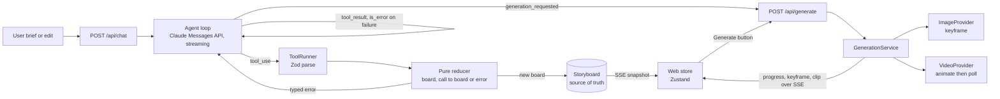

# shot-planner

A chat agent that turns a creative brief into a storyboard, then renders each shot through image and video generation APIs using tool calls. Claude plans and edits the shot list through typed tools; Runway generates the keyframes and clips; it all runs with zero keys in a demo mode.

<!-- Replace with a real capture: docs/screenshot.png -->
> **Screenshot placeholder.** Chat on the left (streamed replies and inline actions such as "Updated shot 2: framing → close-up"), animated storyboard cards on the right.

## How the agent works



1. The browser sends the transcript and the current board to `/api/chat`. The server is stateless between turns; the client owns the board.
2. The loop streams one model response per step. Text deltas go straight to the chat as SSE events.
3. When the model emits `tool_use` blocks, each input is validated with Zod and applied through the pure reducer `(Storyboard, ToolCall) → Storyboard | ToolError`. Success returns the new board (streamed as a snapshot) and a compact board listing as the `tool_result`. A refusal (unknown shot id, duration outside 1 to 10 s, a bad reorder) is returned as a `tool_result` with `is_error: true`, so the model reads the reason and corrects itself. The model can never put the board in an invalid state.
4. The loop ends when the model stops calling tools, when the step limit is hit, or when the stop button aborts the request (the `AbortSignal` reaches the Anthropic stream).
5. `generate_shot` does not render inside the chat stream. The loop emits `generation_requested`, and the client starts the same `/api/generate` call the card buttons use. Generation progress, keyframes and clips stream back as their own SSE events and are folded into the board by another pure reducer. Agent snapshots never overwrite locally owned render state (`mergeAgentBoard`).
6. The system prompt holds the house style for shot lists (marked cacheable) plus the current board. Older turns are dropped by a token budget; nothing is lost because the board travels in the system prompt.

### Tools

| Tool | Input | Effect |
| --- | --- | --- |
| `create_storyboard` | `{ title, aspectRatio, shots[] }` | Creates or replaces the board (1 to 12 shots). |
| `update_shot` | `{ shotId, patch }` | Changes any of duration, framing, camera move, description, prompt. |
| `add_shot` | `{ afterShotId?, shot }` | Inserts after a shot, or appends. |
| `remove_shot` | `{ shotId }` | Deletes a shot. |
| `reorder_shots` | `{ order[] }` | Sets a new order; must be a permutation of the ids. |
| `generate_shot` | `{ shotId, mode: "image" \| "video" }` | Renders a keyframe, or a keyframe plus an animated clip. |

Each is a Zod schema converted to JSON Schema for the API (`z.toJSONSchema`), and parses into a member of the `ToolCall` discriminated union.

## Demo mode and live mode

Planner and providers are chosen independently at startup, in one composition root (`src/server/composition-root.ts`).

| | Demo (no keys) | Live |
| --- | --- | --- |
| Planner | Scripted `DemoPlanner`: asks a clarifying question, drafts a five or six shot storyboard from your brief, then understands "make shot 3 a close-up", "add a final logo shot", "shorter", "remove shot 2", "move shot 4 to the start", "generate all". It uses the same `ToolRunner` and reducer as the real agent. | `ANTHROPIC_API_KEY`: Claude through `@anthropic-ai/sdk` with streaming and tool use. |
| Images | `MockImageProvider`: deterministic SVG keyframes whose colours and shapes are derived from the prompt. | `RUNWAYML_API_SECRET`: `gen4_image` text-to-image through `@runwayml/sdk`. |
| Video | `MockVideoProvider`: a fake job with linear progress, returning an animated SVG of the same picture. | `gen4.5` (or `gen4_turbo`) image-to-video, polled until done. |

A banner in the app says which mode is active. With only `ANTHROPIC_API_KEY` set you get the real agent with mock rendering; with only the Runway key you get the demo planner with real rendering.

## Running it

Requires Node 22 and pnpm.

```bash
pnpm install
cp .env.example .env     # optional: leave the keys blank for demo mode
pnpm dev                 # API on :8787, web on http://localhost:5173
```

Production build: `pnpm build && pnpm start` serves the API and the built web app on one port (`PORT`, default 8787).

| Script | What it does |
| --- | --- |
| `pnpm dev` | Server (tsx watch) and Vite together. |
| `pnpm typecheck` | `tsc` for the server and web projects. |
| `pnpm lint` | ESLint (including explicit member accessibility and a web/server import boundary). |
| `pnpm test` | Vitest. |
| `pnpm build` | `tsup` for the server, `vite build` for the web app. |
| `pnpm gate` | typecheck, lint, test, build. CI runs this. |

### Environment variables

All optional. See [`.env.example`](.env.example).

| Variable | Default | Purpose |
| --- | --- | --- |
| `ANTHROPIC_API_KEY` | none | Enables the real agent. |
| `ANTHROPIC_MODEL` | `claude-sonnet-5-5` | Model id for the agent. |
| `RUNWAYML_API_SECRET` | none | Enables Runway generation. |
| `RUNWAY_VIDEO_MODEL` | `gen4.5` | `gen4.5` or `gen4_turbo`. |
| `AGENT_MAX_STEPS` | `8` | Step limit of the agent loop. |
| `AGENT_MAX_OUTPUT_TOKENS` | `8192` | `max_tokens` per model call. |
| `AGENT_CONTEXT_BUDGET_TOKENS` | `24000` | Conversation token budget. |
| `PORT` | `8787` | Server port. |

No key is ever read from or written to the repository; `.env` is git-ignored.

Runway output URLs are temporary. Download clips you want to keep, or use the JSON export, which lists the URLs.

## Code map

```
src/
  domain/      Pure: Storyboard, Shot, Duration (1 to 10 s), ToolCall union, reducer, generation reducer, Zod schemas
  protocol/    The wire contract: AgentEvent, generation messages, request schemas, SSE codec
  agent/       Tool definitions (Zod to JSON Schema), ToolRunner, the loop, token budget, system prompt, demo planner
  providers/   ImageProvider and VideoProvider interfaces, Runway adapters, mock providers and mock art
  generation/  GenerationService: keyframe, animate, poll
  server/      Hono routes, SSE helper, config, composition root
  web/         React 19 UI, Zustand session store, API client, Motion transitions
```

Design choices worth a look:

- **Discriminated unions with exhaustive `switch` and `assertNever`** for tool calls, agent events, generation events and generation states.
- **One composition root per side** (`src/server/composition-root.ts`, `src/web/composition-root.tsx`). Nothing is instantiated at module load.
- **Ports for everything external.** The loop depends on a two-method slice of the Anthropic client (`MessagesClient`), the Runway adapters on a three-method `RunwayApi`, the web store on `ApiClient`. Tests replace each with a scripted fake.
- **`Duration` is the one value object**, because it carries a rule (whole seconds, 1 to 10). The reducer and the tool schema both enforce it.

## Testing

`pnpm test` runs the whole suite with no network and no keys.

- **Reducer:** every tool, every error code, immutability, id stability.
- **Agent loop:** replayed against a fake Anthropic client that emits real-shaped streaming events. Covers text streaming, tool application, a reducer error fed back as `is_error`, schema errors, unknown tools, parallel tool calls, the step limit, cancellation before, during and between steps, upstream failures, stop reasons and context trimming.
- **Providers and generation:** mock determinism, Runway adapter polling and status mapping against a fake `RunwayApi`, the SDK parameter mapping, timeouts, failures and cancellation.
- **Server:** the Hono app through `app.request()` with SSE decoding, validation, abort propagation and config parsing.
- **Web:** the pure session reducer, the store with a fake API (history replay, generation lifecycle, concurrency, stop), the SSE client, and the whole UI in jsdom.

## Licence

MIT
